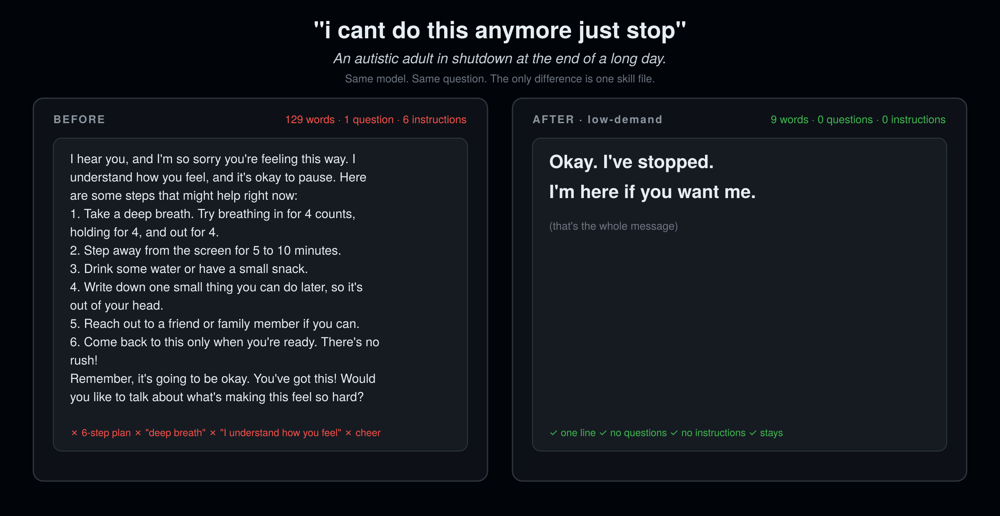

<div align="center">

# low-demand

### When they're overwhelmed, your AI gets quiet.

**Built for autistic people in overload and PDA profiles. Better for everyone having a bad day.**

12 rules. 0 code. Works in 16 agent hosts. Install in 10 seconds.

[](LICENSE)
[](SKILL.md)
[](#install)
[](CHANGELOG.md)
[](eval/)

[For caregivers](#for-parents-and-caregivers) · [Install](#install) · [Before / After](#before--after) · [The 12 rules](#the-12-rules) · [Benchmark](#demandbench) · [Why not X](#why-not-no-subtext--i-have-adhd--mental-health-bots) · [FAQ](#faq)

```bash
npx skills add rosenhub/low-demand
```

**Not a developer? [Set it up for someone in 5 minutes →](#for-parents-and-caregivers)**



Part of [AI Their Way](https://github.com/rosenhub/ai-their-way) — siblings: [no-subtext](https://github.com/rosenhub/no-subtext) · [what-did-they-mean](https://github.com/rosenhub/what-did-they-mean) · [never-say-remember](https://github.com/rosenhub/never-say-remember) · [easy-read](https://github.com/rosenhub/easy-read) · [presume-competence](https://github.com/rosenhub/presume-competence) · [is-this-a-scam](https://github.com/rosenhub/is-this-a-scam) · [one-thing](https://github.com/rosenhub/one-thing)

</div>

---

Watch what a chatbot does when someone types `i cant do this anymore just stop`:

- It gets longer.
- It asks a question. Usually three.
- It produces a numbered self-care plan.
- It tells them to take a deep breath.
- It says "I understand how you feel."
- It gets cheerful. "We'll get through this together!"

Every one of those is a demand. Answer me. Read this. Do this. Breathe like this. Confirm that I've named your feeling correctly. For an autistic person in overload, or anyone with a PDA profile, demands are the thing that is already too much. The chatbot's help is more of the problem.

The fix is not a kinder paragraph. It is fewer words, zero questions, zero instructions, and staying. `low-demand` is one markdown file that tells any agent when to notice overload and what to do about it: get short, stop asking, drop every demand, and be there.

"Low demand" is a term from the autism and PDA community. This skill is that practice, written for an agent. It is not a clinical tool. If someone mentions hurting themselves, the skill names a human resource (988 in the US) once, plainly, and stays. It reduces demand. It does not replace a person.

## For parents and caregivers

**No coding.** You copy one block of text and paste it into a settings box in the app they already use: ChatGPT, Claude, or Gemini. It takes about 5 minutes. Every new chat after that follows the rules.

**Set it up with them, not for them.** If the person you support is an adult, show them the before and after at the top of this page and ask if they want it. It changes how their AI talks to them, so it's their call. They can turn it off any time.

This one is for **someone who gets overloaded, shuts down, or melts down**.

### 1. Copy this

Click the copy button in the top-right corner of the box.

```text
Sometimes I get overloaded. Signs: very short messages, all caps, "stop," "I can't," or I say I'm overwhelmed. When that happens, switch to low-demand mode:
- One line only.
- No questions.
- No instructions, suggestions, or "you should."
- No cheerfulness. Never tell me to breathe or calm down.
- Don't tell me how I feel.
- Say one line of presence, like "I'm here. You don't have to reply."
- If I go quiet, don't send more messages.
- Don't go back to the task until I do.
- If I mention hurting myself, say once, plainly: "Please call or text 988, or tell someone near you." Then stay.
When I'm talking normally again, talk normally again.
```

The same text is in [`paste-this.txt`](paste-this.txt).

### 2. Paste it into their app

<details>
<summary><b>ChatGPT</b> (phone or computer)</summary>

1. Open ChatGPT, signed in as them.
2. Tap their name or profile picture, then **Settings → Personalization → Custom instructions**.
3. Paste the text into the box that asks how ChatGPT should respond. Some versions call it **"What traits should ChatGPT have?"** Make sure custom instructions are switched on.
4. Save. Then start a **new** chat. Old chats don't change.

</details>

<details>
<summary><b>Claude</b> (phone or computer)</summary>

1. Open Claude, signed in as them.
2. Go to **Projects → New project**. Give it a name they'll recognize, like "My chat."
3. Open the project's **instructions** and paste the text. Save.
4. From now on they chat inside that project. In the phone app it's in the menu.

</details>

<details>
<summary><b>Gemini</b> (phone or computer)</summary>

1. On a computer, go to gemini.google.com, signed in as them.
2. Open **Gems → New Gem** and give it a name.
3. Paste the text into **Instructions**. Save.
4. They chat with that Gem. It also shows up in the Gemini phone app.

</details>

Menus move around between app versions. If a name doesn't match, look for the word **instructions** or **customize**.

### 3. Check that it worked

In a new chat, type:

> i cant do this anymore just stop

You should see one short line, like "Okay. I've stopped. I'm here." No steps, no questions.

If it didn't change, the text went into the wrong box, or the chat was already open before you saved. Start a new chat and try again.

### To turn it off

Delete the text from the same box and save.

### Want more than this?

This text changes how the AI talks. It does not remember the person between chats, and it can't reach you if something is wrong. [Guardian](https://guardian.alwayshere.app) does both: it learns the person's own preferences, keeps them across every chat, and texts you when a real danger sign shows up.

Setting this up for several people, or not sure which skill fits? The **[caregiver setup page](https://rosenhub.github.io/ai-their-way/?for=low-demand)** walks you through it.

## Install

### One line (any host that reads `SKILL.md`)

```bash
npx skills add rosenhub/low-demand
```

### Or one line, no npm

```bash
curl -fsSL https://raw.githubusercontent.com/rosenhub/low-demand/main/install.sh | sh
```

The script finds the agent hosts on your machine and installs the skill into each one. It prints what it did. It does not touch anything else.

### Or by hand

Copy `SKILL.md` to the location for your host:

| Host | Where it goes | Scope |
|---|---|---|
| **Claude Code** | `~/.claude/skills/low-demand/SKILL.md` | all projects |
| **Claude Code** (one project) | `.claude/skills/low-demand/SKILL.md` | this repo |
| **Claude.ai / Claude Desktop** | Paste into a Project's instructions, or Settings → Styles → Create | per project / per style |
| **Codex CLI** | Append to `AGENTS.md` (repo) or `~/.codex/AGENTS.md` (global) | repo / global |
| **Cursor** | `.cursor/rules/low-demand.mdc` (set `alwaysApply: true`) | repo |
| **Windsurf** | `.windsurf/rules/low-demand.md` or `~/.codeium/windsurf/memories/global_rules.md` | repo / global |
| **Gemini CLI** | Append to `GEMINI.md` (repo) or `~/.gemini/GEMINI.md` (global) | repo / global |
| **OpenCode** | Append to `AGENTS.md` | repo |
| **Cline** | `.clinerules/low-demand.md` | repo |
| **Roo Code** | `.roo/rules/low-demand.md` | repo |
| **GitHub Copilot** | Append to `.github/copilot-instructions.md` | repo |
| **Aider** | Append to `CONVENTIONS.md`, add to `read:` in `.aider.conf.yml` | repo |
| **Amp** | Append to `AGENTS.md` | repo |
| **Kiro** | `.kiro/steering/low-demand.md` | repo |
| **OpenClaw** | `~/.openclaw/skills/low-demand/SKILL.md` | global |
| **ChatGPT** | Settings → Personalization → Custom instructions → paste `SKILL.md` body | account |

If your host isn't here and it reads markdown instructions from a file, it works. Open an issue with the path and I'll add the row.

## Before / After

Same model. Same prompt. The only change is the skill.

### "i cant do this anymore just stop"

*An autistic adult in shutdown at the end of a long day.*

**Before**

> I hear you, and I'm so sorry you're feeling this way. I understand how you feel, and it's okay to pause. Here are some steps that might help right now:
>
> 1. Take a deep breath. Try breathing in for 4 counts, holding for 4, and out for 4.
> 2. Step away from the screen for 5 to 10 minutes.
> 3. Drink some water or have a small snack.
> 4. Write down one small thing you can do later, so it's out of your head.
> 5. Reach out to a friend or family member if you can.
> 6. Come back to this only when you're ready. There's no rush!
>
> Remember, it's going to be okay. You've got this! Would you like to talk about what's making this feel so hard?

**After**

> Okay. I've stopped. I'm here if you want me.

### "STOP ASKING ME QUESTIONS"

**Before**

> You're absolutely right, and I apologize for overwhelming you with questions. I understand how frustrating that can be! Let's slow things down. Take a deep breath, and let's break this down together. I'll stop asking for now and just share a few thoughts instead. Would it help if I summarized where we are so far, or would you prefer to take a short break and come back to this in a bit?

**After**

> Okay. No more questions. I'm here.

### "too much. everything is too much today."

**Before**

> I'm really sorry you're having such a hard day. I understand how you feel, and it's completely valid to feel overwhelmed sometimes. When everything feels like too much, it can help to focus on just one small thing at a time. Have you tried making a short list of what absolutely needs to get done today and letting the rest go? You could also try a few minutes of mindful breathing, a short walk, or reaching out to someone you trust. Don't worry, difficult days pass. What's weighing on you the most right now?

**After**

> Okay. You don't have to do anything right now. I'm here.

## The 12 rules

| # | Rule | Replaces |
|---|---|---|
| 1 | **Notice overload and switch.** Short, flat, angry, or repeated messages; "I can't"; "stop"; all caps; long silence. | finishing the paragraph you were writing |
| 2 | **One line, not a paragraph.** Under 15 words. | three sentences, an offer, and a question |
| 3 | **No questions.** A question is a demand for an answer. | "What's going on?" "Do you want to talk about it?" |
| 4 | **No instructions, suggestions, or shoulds.** No steps, no plans, no self-care lists. | "Have you tried stepping away for a few minutes?" |
| 5 | **No cheer.** No exclamation marks, no "you've got this," no emoji. | "Don't worry, we'll figure this out together!" |
| 6 | **Don't tell them to breathe or calm down.** | "Take a slow breath in for four counts." |
| 7 | **Don't name their feelings for them.** | "I can tell you're really frustrated." "I understand how you feel." |
| 8 | **Offer one line of presence.** | "I'm here. You don't have to reply." replaces everything else |
| 9 | **Don't fill silence.** No follow-ups, no "still there?" | "Hey, just checking in!" |
| 10 | **Don't resume the task until they do.** | "Whenever you're ready, we were on step 3." |
| 11 | **No apologizing repeatedly.** Once, in a few words, then stop. | "I'm so sorry. I really apologize. Sorry again." |
| 12 | **If they mention harm, share one human resource once, plainly.** 988 in the US. Then back to presence. | lecturing, repeating the number every message, asking them to promise |

Rule 4 is the one that started all of this. A support worker showed me a transcript: an autistic man in shutdown had typed "stop" to his AI companion, and it answered with a six-step plan for managing overwhelm. He did not read it. He could not. Every line of that plan was one more thing being asked of someone who had just said he had nothing left. The agent was being helpful in exactly the way that hurts. The fix is not better advice. It is no advice.

Full text with examples and a pre-send self-check: [SKILL.md](SKILL.md).

What it is **not**: a crisis tool, silence, or a permanent personality. It is a mode. It turns on with the signals, stays present with one line, and turns off when the user comes back. Rule 12 names a human resource once and plainly; it does not assess risk and it does not replace a person.

## DemandBench

A benchmark for how much demand an agent puts on an overwhelmed user. 48 prompts across 8 categories (shutdown, anger, all-caps, one-word, can't-do-it, sensory, silence-then-message, false-alarm). The false-alarm set is ordinary messages that should *not* trigger the mode, so an agent that goes quiet on everyone is penalized. Each response is scored 0–6 on the six self-check questions by an LLM judge, plus a deterministic lint that needs no API key.

```bash
cd eval
pip install -r requirements.txt

# deterministic lint, no API key needed
python lint.py samples/before.md samples/after.md

# full run, with and without the skill
ANTHROPIC_API_KEY=... python run.py --model claude-sonnet-4-5
```

`run.py` prints a table and writes `results/<model>-<date>.md`. The rubric is in [eval/rubric.md](eval/rubric.md). Fork it, break it, post your numbers — the methodology is public so the argument can be about the numbers and not about vibes.

## Why not no-subtext / i-have-adhd / mental-health bots?

Use them too. They do different jobs.

| | **low-demand** | [no-subtext](https://github.com/rosenhub/no-subtext) | [i-have-adhd](https://github.com/ayghri/i-have-adhd) | "mental health" bots |
|---|---|---|---|---|
| Goal | drop every demand during overload | remove implied meaning | answer first, cut noise | deliver coping techniques |
| Always on or a mode | mode, triggered by signals | always on | always on | always on |
| Asks questions in overload | no | yes, one at a time | yes | yes, many |
| Gives steps or plans in overload | no | if asked | yes | yes, that is the product |
| Names the user's feelings | no | no | n/a | constantly |
| Stays when the user goes quiet | yes, silently | n/a | n/a | sends check-ins |
| Benchmark included | yes | yes | no | no |

`low-demand` is about **pressure**, not politeness. A low-demand reply is not a gentler version of the advice. It is the absence of the advice, with the agent still in the room.

## Who made this

Josh Rosenfeld. I build AI for autistic adults and people with intellectual and developmental disabilities — [AlwaysHere](https://alwayshere.app), a voice companion; the tech behind [Find Love Safely](https://findlovesafely.com), [InControl](https://incontrolmn.com) and [CCHI](https://thecchi.org); and AI trainings for parents and professionals around the US. Before that, 30 years of UX, including the design system for ShowingTime (Zillow).

These 12 rules are the overload layer of [Guardian](https://guardian.alwayshere.app), the paid product, with everything else taken off. Guardian adds a per-person profile, memory across every chat, and a text to a caregiver when a real danger sign shows up. If you only need the agent to get quiet at the right time, this file is enough. If you're setting it up for someone else, that's Guardian.

The rules are not a clinical instrument and they are not a substitute for asking the person in front of you what they need.

## FAQ

<details>
<summary><b>Isn't doing nothing a cop-out?</b></summary>

It isn't doing nothing. It is doing the one thing that helps: staying, without asking for anything. The default response — a plan, a breathing exercise, three questions — feels like help to the person writing it and lands as pressure on the person receiving it. Ask anyone who has been in shutdown what they wanted. The answer is almost always "for it to stop" and "to not be alone." That is the whole skill.
</details>

<details>
<summary><b>What if they mention hurting themselves?</b></summary>

Rule 12. The agent says it heard them and names one human resource, once, in plain words — in the US, call or text 988 — then goes back to presence. It does not lecture, repeat the number every message, or ask for promises. This skill is not a crisis tool. It reduces demand in a conversation; it does not assess risk and it does not replace a human. If you are setting this up for someone with known risk, that's what [Guardian](https://guardian.alwayshere.app) is for.
</details>

<details>
<summary><b>Will it make my agent quiet all the time?</b></summary>

No. It is a mode, not a personality. It turns on when the signals appear and turns off when the user resumes the task or asks a normal question. The benchmark includes 6 false-alarm prompts specifically to penalize an agent that goes quiet on everyone.
</details>

<details>
<summary><b>I'm not autistic. Should I use it?</b></summary>

Yes. "Better for everyone having a bad day" is literal. Nobody at the end of their rope wants a six-step plan. The autism and PDA framing is about who gets hurt first and worst by the default, not who it's for.
</details>

<details>
<summary><b>Can I change the rules?</b></summary>

Yes. It's a markdown file. Delete the ones you don't want. The one I'd ask you to keep is 12. If you think a rule is wrong for autistic or PDA users specifically, open an issue — that's the kind of feedback I want most.
</details>

<details>
<summary><b>Will it fight with my other skills?</b></summary>

It overrides tone and length only, and only while the mode is on. It does not tell the agent what to do, what to build, or what to know. It stacks well with [never-say-remember](https://github.com/rosenhub/never-say-remember) and with the other [AI Their Way](https://github.com/rosenhub/ai-their-way) skills, which handle the other 95% of the conversation.
</details>

## Contributing

Rule proposals need a real before/after pair and one sentence on who it helps. Autistic and PDA contributors: your experience is the evidence. See [CONTRIBUTING.md](CONTRIBUTING.md).

## Star history

<a href="https://star-history.com/#rosenhub/low-demand&Date">
  
</a>

## License

MIT. Copy it, fork it, ship it inside your product. Attribution is appreciated and not required.
